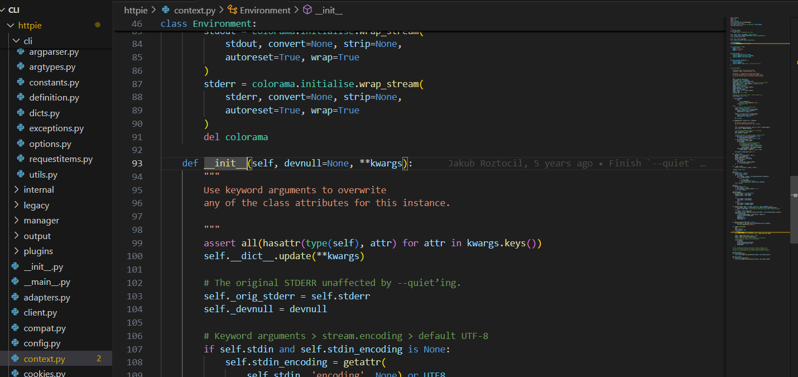
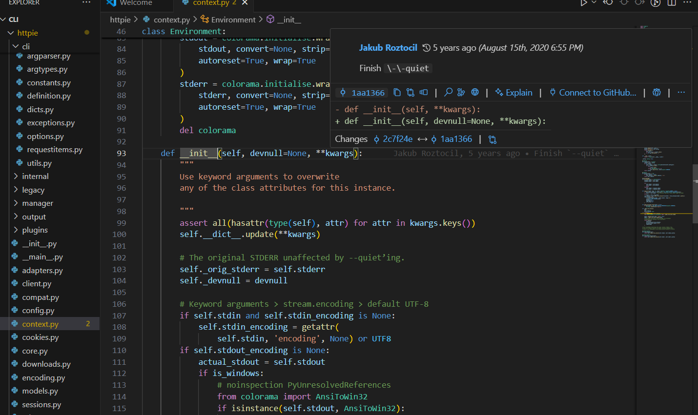

## GitLens Insights for `__init__()` function in context.py

- **Author**: Jakub Roztocil
- **Last Updated**: 5 years ago (August 15th, 2020 6:55 PM)
- **Commit**: Finish \-\-quiet

### Screenshots

